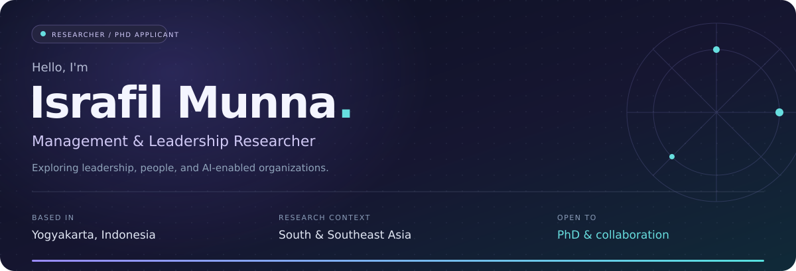
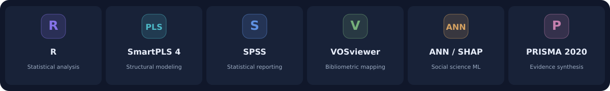

  

  <a href="PUBLICATIONS.md"><b>PUBLICATIONS</b></a> &nbsp; / &nbsp;
  <a href="RESEARCH.md"><b>RESEARCH & METHODS</b></a> &nbsp; / &nbsp;
  <a href="ACADEMIC_PROFILE.md"><b>ACADEMIC PROFILE</b></a> &nbsp; / &nbsp;
  <a href="mailto:israfil.munna.psc25@mail.umy.ac.id"><b>LET'S CONNECT ↗</b></a>

  

## A little about me

I research the intersection of **leadership, artificial intelligence, and human resource management**—how people and organizations navigate digital change, build trust, and work toward sustainable performance.

My work focuses on **Bangladesh and Indonesia**, connecting management theory with the realities of emerging economies across South and Southeast Asia.

- 🔭 **Researching:** digital leadership, AI adoption, human–AI collaboration, and employee outcomes.
- 🎓 **Seeking:** fully funded PhD opportunities in Management, Leadership, HRM, or Organizational Behavior.
- 🤝 **Collaborating on:** quantitative studies, qualitative inquiry, systematic reviews, and bibliometric research.
- 🌏 **Based in:** Yogyakarta, Indonesia; originally from Bangladesh.

<table>
<tr>
<td align="center" width="33%"><h2>08</h2><b>JOURNAL ARTICLES</b> Listed in my October 2026 CV</td>
<td align="center" width="34%"><h2>13</h2><b>MANUSCRIPTS UNDER REVIEW</b> Status reported October 2026</td>
<td align="center" width="33%"><h2>3.90 / 4.00</h2><b>MASTER'S CGPA</b> Fully funded scholarship · UMY</td>
</tr>
</table>

## My research toolkit

  <picture>
  <source media="(max-width: 600px)" srcset="assets/v3/toolkit-mobile.svg" />
  
  </picture>

**Quantitative research** · PLS-SEM, survey design, measurement models, higher-order constructs, mediation, and bootstrapping.  
**Qualitative inquiry** · Semi-structured interviews, thematic analysis, phenomenological approaches, and sensemaking.  
**Evidence synthesis** · Systematic literature reviews, bibliometrics, co-citation, and keyword co-occurrence mapping.

[Explore my methods and current manuscripts →](RESEARCH.md)

## Selected work

### 01 &nbsp; Leadership, ethics & organizational life

**The practice of Islamic spiritual leadership in Bangladeshi organizations: A qualitative inquiry.**  
*Human Systems Management · 2026 · Advance online publication*  
[Read the paper ↗](https://doi.org/10.1177/01672533261498592)

### 02 &nbsp; Leading human–AI collaboration

**Digital leadership and human–AI collaboration for sustainable organizational performance: A systematic literature review and future research agenda.**  
*International Journal of Organizational Leadership · 2026*  
[Read the paper ↗](https://doi.org/10.33844/ijol.2026.60554)

### 03 &nbsp; Understanding AI adoption

**Understanding ChatGPT adoption among university students in Yogyakarta, Indonesia: An extended value-based adoption model using hybrid structural equation modeling and machine learning analysis.**  
*Education Science and Management · 2025*  
[Read the paper ↗](https://doi.org/10.56578/esm030402)

**[View all eight journal articles and full citations →](PUBLICATIONS.md)**

## Beyond the papers

### 🎓 Academic foundation

**Master of Management (Human Resource)** · Universitas Muhammadiyah Yogyakarta  
Fully funded scholarship · **CGPA 3.90/4.00**. Academic requirements completed July 2026; **formal degree conferral pending**.

**BA (Hons), English Language and Literature** · Asian University of Bangladesh  
**CGPA 3.71/4.00** · 2019–2023.

### 🏅 Leadership & service

**Director of Research and Professional Development** · International Students Association, UMY · October 2025–Present.

**Best Paper Award — Human Resource Track** · International Student Colloquium Collaboration · December 2025.

**Invited peer-review service** · International Journal of Education and Practice; Asian Journal of Interdisciplinary Research · June 2026.

<b>More about my academic journey ↗</b>

**International programs:** UIN Walisongo, Universitas Negeri Semarang, Universitas Gadjah Mada, and Universitas Andalas in 2026.

**Earlier experience:** Assistant English Teacher, Education Prime School, Dhaka · January 2021–December 2023.

**Languages:** Bengali (native), English (B2), Hindi (B2 with A2 writing), Indonesian (A2).

[Read my full academic profile →](ACADEMIC_PROFILE.md)

---

<h2 align="center">Good research starts with a conversation.</h2>

Open to <b>PhD supervision opportunities</b>, <b>research partnerships</b>, and <b>academic collaboration</b>.

  <a href="mailto:israfil.munna.psc25@mail.umy.ac.id"><b>EMAIL ME ↗</b></a> &nbsp; • &nbsp;
  <a href="https://www.linkedin.com/in/israfilmunna/"><b>LINKEDIN</b></a> &nbsp; • &nbsp;
  <a href="https://scholar.google.com/citations?user=hfNSEOEAAAAJ&amp;hl=en"><b>GOOGLE SCHOLAR</b></a> &nbsp; • &nbsp;
  <a href="https://www.scopus.com/authid/detail.uri?authorId=60781126500"><b>SCOPUS</b></a> &nbsp; • &nbsp;
  <a href="https://orcid.org/0009-0007-4544-6769"><b>ORCID</b></a>

Leadership · People · AI · Sustainable organizations Academic information aligned with my CV, October 2026.

