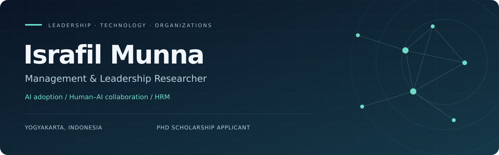

  

  
  
  
  

  <a href="PUBLICATIONS.md"><b>Publications</b></a> &nbsp; / &nbsp;
  <a href="RESEARCH.md"><b>Research &amp; Methods</b></a> &nbsp; / &nbsp;
  <a href="ACADEMIC_PROFILE.md"><b>Academic Profile</b></a> &nbsp; / &nbsp;
  <a href="https://www.scopus.com/authid/detail.uri?authorId=60781126500"><b>Scopus</b></a>

---

### Understanding leadership in an AI-enabled world

I study how **leadership, AI adoption, and human resource practices** shape employee experiences and sustainable organizational performance. My research connects management theory with organizational challenges in **Bangladesh, Indonesia, and emerging economies across South and Southeast Asia**.

At **Universitas Muhammadiyah Yogyakarta (UMY)**, I completed the academic requirements for a fully funded **Master of Management (Human Resource)** in July 2026, with a **CGPA of 3.90/4.00**. Formal degree conferral is pending.

**Open to fully funded PhD opportunities and research collaboration** in leadership, organizational behavior, HRM, and AI-enabled management.

<table>
<tr>
<td align="center" width="33%"><h3>08</h3><b>Journal articles</b> Listed in my current CV</td>
<td align="center" width="34%"><h3>13</h3><b>Manuscripts under review</b> Status reported October 2026</td>
<td align="center" width="33%"><h3>2025</h3><b>Best Paper Award</b> Human Resource Track · ISCC</td>
</tr>
</table>

## Research agenda

<table>
<tr>
<td width="50%" valign="top">
<h3>01 · Leadership &amp; AI</h3>
Digital leadership, AI adoption, digital readiness, and human–AI collaboration in changing workplaces.
</td>
<td width="50%" valign="top">
<h3>02 · People &amp; Organizations</h3>
E-HRM, employee engagement, organizational behavior, and sustainable organizational performance.
</td>
</tr>
<tr>
<td width="50%" valign="top">
<h3>03 · Responsible Management</h3>
Sustainable and responsible leadership, AI-HRM governance, trust, and perceived fairness.
</td>
<td width="50%" valign="top">
<h3>04 · Emerging Economies</h3>
Higher education and organizational research in Bangladesh, Indonesia, and South and Southeast Asia.
</td>
</tr>
</table>

## Selected publications

**Islamic spiritual leadership in Bangladeshi organizations**  
A qualitative inquiry into leadership practice.  
*Human Systems Management · 2026 · Advance online publication*  
[Read article ↗](https://doi.org/10.1177/01672533261498592)

**Digital leadership & human–AI collaboration**  
A systematic literature review and future research agenda for sustainable organizational performance.  
*International Journal of Organizational Leadership · 2026*  
[Read article ↗](https://doi.org/10.33844/ijol.2026.60554)

**Transformational leadership, AI readiness & innovative work behavior**  
A study of the pathway to innovative work behavior in Indonesian higher education.  
*Human Resources Management and Services · 2026*  
[Read article ↗](https://doi.org/10.18282/hrms6117)

**ChatGPT adoption among university students**  
An extended value-based adoption model using hybrid SEM and machine learning in Yogyakarta.  
*Education Science and Management · 2025*  
[Read article ↗](https://doi.org/10.56578/esm030402)

[**Explore all eight journal articles and full citations →**](PUBLICATIONS.md)

## Methodological toolkit

| Approach | Research practice | Tools & frameworks |
| :--- | :--- | :--- |
| **Quantitative** | Survey design, measurement models, higher-order constructs, mediation, bootstrapping | SmartPLS 4 · SPSS · R |
| **Qualitative** | Semi-structured interviews, coding, thematic analysis, interpretative inquiry | Phenomenological & sensemaking approaches |
| **Evidence synthesis** | Systematic reviews, screening, extraction, thematic synthesis | PRISMA 2020 |
| **Bibliometric** | Co-citation, keyword co-occurrence, network mapping, thematic clustering | Scopus · VOSviewer |
| **Machine learning** | Machine learning for social science | ANN · SHAP |

[Research methods, current manuscripts, and doctoral direction →](RESEARCH.md)

## Academic journey

**2025–Present · Master of Management (Human Resource)**  
Universitas Muhammadiyah Yogyakarta, Indonesia  
Fully funded scholarship · **3.90/4.00** · Academic requirements completed July 2026; degree conferral pending.

**2019–2023 · BA (Hons), English Language and Literature**  
Asian University of Bangladesh, Dhaka  
**3.71/4.00** · Foundations in critical analysis, qualitative interpretation, and scholarly writing.

## Leadership & academic service

- **Director of Research and Professional Development, ISA UMY** · October 2025–Present  
  Academic partnerships, research forums, leadership workshops, and professional development for international students.
- **Best Paper Award — Human Resource Track** · December 2025  
  International Student Colloquium Collaboration; co-authored research on transformational leadership, innovation, and employee creativity.
- **Invited peer-review service** · June 2026  
  International Journal of Education and Practice; Asian Journal of Interdisciplinary Research.
- **ISA International Research Bootcamp recognition** · 2026  
  Certificate of Appreciation for leadership, coordination, and contribution.

<b>International programs, languages & earlier experience</b>

### International academic programs · 2026

- **UIN Walisongo** · Language and cultural heritage · 10–12 August
- **Universitas Negeri Semarang** · Community-based learning, entrepreneurship, and sustainable rural development · 1–2 August
- **Universitas Gadjah Mada** · Ecosystem services and climate change · 7–20 July
- **Universitas Andalas** · Indonesian sociocultural and political dynamics, with a focus on Minangkabau society · 23–30 June

### Languages

Bengali: native · English: B2 · Hindi: B2 in listening, reading, speaking, and interaction; A2 writing · Indonesian: A2.

### Earlier professional experience

**Assistant English Teacher**, Education Prime School, Dhaka · January 2021–December 2023. English instruction, teaching materials, classroom facilitation, and student progress tracking.

[Full academic profile →](ACADEMIC_PROFILE.md)

---

### Let’s advance management research together

I welcome conversations with **prospective PhD supervisors, academic collaborators, and research teams** exploring leadership, AI adoption, human–AI collaboration, HRM, and sustainable organizations.

**[Email me](mailto:israfil.munna.psc25@mail.umy.ac.id)** &nbsp; · &nbsp; **[Connect on LinkedIn](https://www.linkedin.com/in/israfilmunna/)** &nbsp; · &nbsp; **[Explore my research](https://scholar.google.com/citations?user=hfNSEOEAAAAJ&hl=en)**

Yogyakarta, Indonesia · Academic information aligned with my CV, October 2026.
