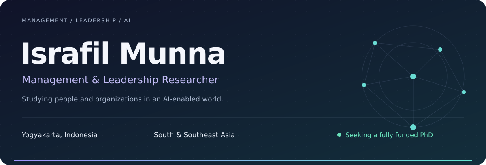
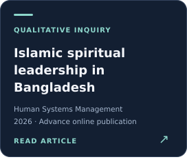
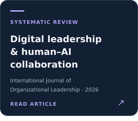
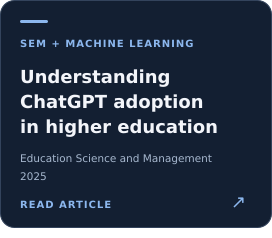
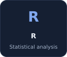
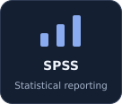
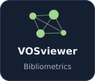
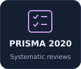

<picture>
  <source media="(max-width: 600px)" srcset="assets/profile/hero-mobile.svg" />
  
</picture>

  
  
  

## About me

I’m **Israfil Munna**, an early-career management researcher exploring how **leadership, AI adoption, and human resource practices** shape employee experiences and sustainable organizational performance. My work focuses on **Indonesia and Bangladesh**, with a broader interest in South and Southeast Asian emerging economies.

At **Universitas Muhammadiyah Yogyakarta (UMY)**, I completed the academic requirements for a fully funded **Master of Management (Human Resource)** in July 2026, with a **CGPA of 3.90/4.00**. Formal degree conferral is pending.

> **Seeking a fully funded PhD** in Management, Leadership, HRM, Organizational Behavior, or AI-enabled management. I welcome conversations with prospective supervisors and research collaborators.

  
  
  
  
  

## Research directions

**Leadership & intelligent organizations**  
Digital leadership, AI adoption, employee readiness, and human–AI collaboration.

**People & sustainable performance**  
E-HRM, employee engagement, organizational behavior, and responsible leadership.

**Higher education & emerging economies**  
Management research grounded in the organizational contexts of Bangladesh and Indonesia.

## Selected publications

  
  
  

**[8 journal articles](PUBLICATIONS.md)** · **[13 manuscripts under review](RESEARCH.md#manuscripts-under-review)** · **[1 manuscript in preparation](RESEARCH.md#manuscript-in-preparation)**  
Articles listed and manuscript statuses reported in my October 2026 CV.

[Full citations →](PUBLICATIONS.md) &nbsp; · &nbsp; [Download BibTeX →](https://raw.githubusercontent.com/israfilmunna/israfilmunna/main/publications.bib)

## Research toolkit

  
  
  
  
  
  

- **Quantitative:** Survey design, measurement models, higher-order constructs, mediation, and bootstrapping.
- **Qualitative:** Semi-structured interviews, coding, thematic analysis, and interpretative inquiry.
- **Evidence synthesis:** Systematic literature reviews, co-citation analysis, keyword co-occurrence, and network mapping.
- **Research practice:** Academic writing, data quality control, APA 7, DOI verification, manuscript revision, and peer review.

[Explore my methods and research agenda →](RESEARCH.md)

## Leadership & academic service

**Director of Research and Professional Development** · ISA, UMY  
October 2025–Present · Research forums, academic partnerships, leadership workshops, and professional development for international students.

**Best Paper Award — Human Resource Track**  
International Student Colloquium Collaboration · 13 December 2025. Co-authored research on transformational leadership, innovation, and employee creativity.

**Invited peer-review service**  
International Journal of Education and Practice; Asian Journal of Interdisciplinary Research · June 2026.

<b>Education, international programs & languages</b>

**Master of Management (Human Resource)** · UMY · September 2025–Present. Fully funded scholarship; CGPA **3.90/4.00**. Academic requirements completed July 2026; degree conferral pending.

**BA (Hons), English Language and Literature** · Asian University of Bangladesh · September 2019–December 2023. CGPA **3.71/4.00**.

**International programs, 2026:** Universitas Andalas, Universitas Gadjah Mada, Universitas Negeri Semarang, and UIN Walisongo.

**Languages:** Bengali (native); English (B2); Hindi (B2 in listening, reading, speaking, and interaction, with A2 writing); Indonesian (A2).

[Full academic profile →](ACADEMIC_PROFILE.md)

---

### Let's connect

I welcome collaboration on **leadership, AI adoption, human–AI collaboration, HRM, and sustainable organizations**—including empirical studies, systematic reviews, and bibliometric research.

**[israfil.munna.psc25@mail.umy.ac.id](mailto:israfil.munna.psc25@mail.umy.ac.id)**  
Yogyakarta, Indonesia · [LinkedIn](https://www.linkedin.com/in/israfilmunna/) · [Google Scholar](https://scholar.google.com/citations?user=hfNSEOEAAAAJ&hl=en) · [ORCID](https://orcid.org/0009-0007-4544-6769)
